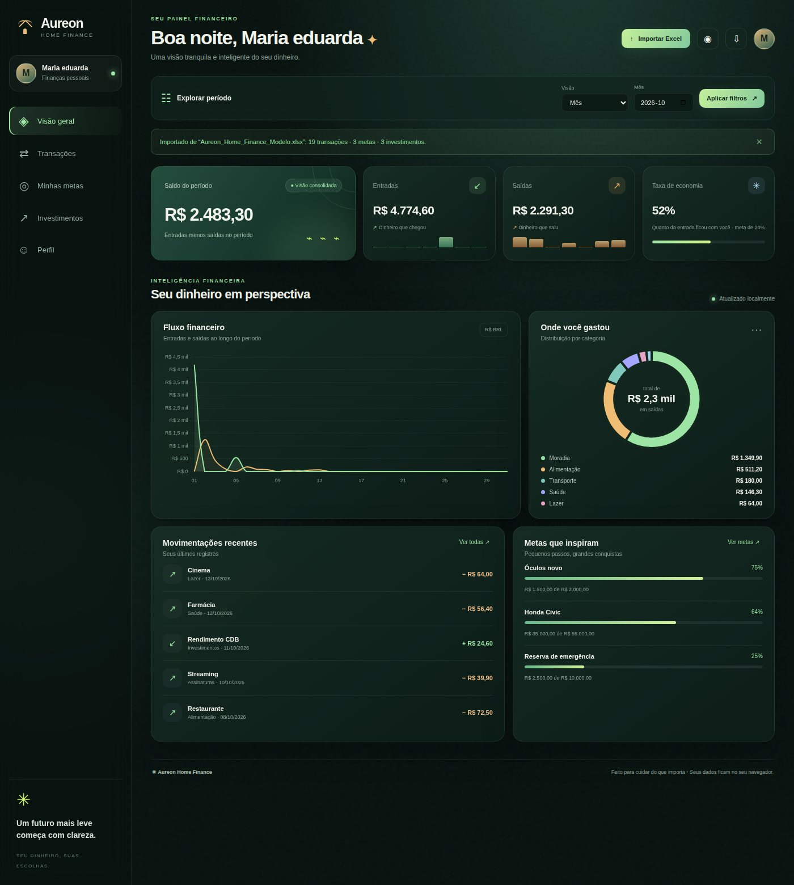

# Aureon Home Finance

Dashboard de finanças pessoais em HTML, CSS e JavaScript puro. Você importa **uma planilha Excel** e o app mostra transações, metas e investimentos, sem backend, sem conta e sem enviar nada para a internet: os dados ficam no seu navegador.



| Primeira abertura | Metas |
|---|---|
|  |  |

## Como usar

1. Abra o `index.html` no Chrome ou Edge (duplo clique) ou acesse o site publicado.
2. Informe seu nome na tela de boas-vindas. Ele só personaliza a saudação e o avatar; não existe senha nem conta online.
3. O app começa **vazio**. Baixe a **planilha modelo** (botão no painel inicial ou em *Perfil*), preencha e clique em **Importar Excel**.

Transações, metas e investimentos vêm **da mesma planilha** (uma aba para cada). Importar substitui o que estava no app; se já houver dados, o app pede confirmação antes.

## A planilha

Abas reconhecidas (com ou sem acento, em qualquer caixa): `Transacoes`, `Metas`, `Investimentos`. Uma aba que não existe resulta em lista vazia. Os cabeçalhos também ignoram acento, caixa, espaço e underscore (`Valor_Alvo`, `valor alvo` e `VALOR ALVO` são iguais). `*` = obrigatório.

| Aba | Colunas |
|---|---|
| **Transacoes** | `Data`\*, `Valor`\*, `Tipo`, `Descricao`, `Categoria`, `Conta_Origem`, `Meio_Pagamento`, `Status`, `Subcategoria`, `Instituicao`, `Recorrente`, `Observacoes`, `ID` |
| **Metas** | `Meta`\*, `Valor_Alvo`\*, `Valor_Atual`, `Data_Alvo`, `Prioridade`, `Imagem_URL`, `Observacoes` |
| **Investimentos** | `Ativo`\*, `Valor_Investido`\*, `Taxa_Anual_%_CDI`, `CDI_Anual_%`, `Instituicao`, `Tipo`, `Liquidez`, `Data_Aplicacao`, `Vencimento`, `Observacoes` |

Datas aceitam `2026-10-01`, `01/10/2026` e datas nativas do Excel. Valores aceitam número ou texto (`R$ 1.234,56`, `1.500`, `-5,00`, `(5,00)`).

### Como o app entende Entrada e Saída

Maiúsculas, minúsculas, acentos e espaços sobrando **não importam**: `Saída`, `Saida`, `SAIDA`, `saida` e ` saída ` são a mesma coisa. Para cada linha, nesta ordem:

1. **Coluna `Tipo` reconhecida**: Entrada (receita, crédito, salário, rendimento, depósito, `E`, `+`...) ou Saída (despesa, débito, gasto, pagamento, compra, saque, `S`, `-`...).
2. **Valor negativo** (`-50`, `(50,00)`) = Saída.
3. **Sem coluna `Tipo`, mas com valores negativos**: os positivos são Entrada.
4. **Colunas separadas `Entrada` e `Saída`** (ou Receita/Despesa, Crédito/Débito): vale a coluna preenchida.
5. **Qualquer outro caso** vira Saída **e o app avisa** quais textos não reconheceu, além de linhas sem data e valores zerados ou ilegíveis.

Status (`Confirmado`, `Pendente`, `Cancelado`), prioridade (`Alta`, `Média`, `Baixa`), meio de pagamento e categoria seguem a mesma regra, e categorias iguais com grafias diferentes entram na mesma fatia dos gráficos. Para ensinar uma palavra nova, edite as listas em `js/data/vocabulary.js`.

## Imagens das metas

No modal da meta ou na coluna `Imagem_URL`:

1. **Link direto da imagem**: deve abrir só a imagem quando colado numa aba (termina em `.jpg`, `.png`, `.webp`). Ex.: `https://i.imgur.com/AbC123.jpg`.
2. **Arquivo na pasta `img/`**: use o caminho relativo, como `img/civic.jpg`. Funciona offline.
3. **Upload pelo modal**: reduzido no navegador e guardado localmente. Não vai para a planilha, mas entra no backup `.json`.

Links de compartilhamento do Google Drive e do Dropbox são convertidos automaticamente (o arquivo precisa estar acessível a "qualquer pessoa com o link"). Links de páginas (Google Imagens, Pinterest, Instagram) não funcionam. Se a imagem não carregar, o cartão volta ao ícone e o app avisa.

## Privacidade e segurança

- Tudo é processado no navegador. O app não tem servidor e não envia dados para lugar nenhum.
- Os dados ficam no `localStorage` (limite de ~5 MB). Limpar os dados do navegador apaga a cópia local, então baixe um **backup** de vez em quando (*Perfil → Seus dados*).
- **Nunca versione suas finanças.** O `.gitignore` já exclui `*.xlsx`, `*.xls`, `*.csv` e `Aureon_Backup_*.json`; a única planilha versionada é a modelo (dados fictícios) em `assets/`.
- SheetJS e Chart.js ficam em `vendor/` (sem CDN), então o app funciona offline. O `vercel.json` aplica uma Content-Security-Policy restritiva (`script-src 'self'`) e outros cabeçalhos de segurança.
- A versão do SheetJS no npm é a `0.18.5`; versões mais novas só existem no site oficial deles. Por isso, importe apenas planilhas suas ou de fontes confiáveis.

## Publicar no GitHub e na Vercel

```bash
git init
git add .
git status          # confira: nenhuma planilha pessoal deve aparecer
git commit -m "Aureon Home Finance"
git branch -M main
git remote add origin https://github.com/SEU-USUARIO/aureon-home-finance.git
git push -u origin main
```

Na Vercel: **Add New → Project → Import** o repositório e clique em **Deploy**. O `vercel.json` já define tudo (`node build.mjs --dist`, saída em `dist/`, cabeçalhos de segurança); nenhum ajuste de framework é necessário. Cada `git push` publica uma nova versão.

O workflow de CI (`.github/workflows/ci.yml`) roda a cada push e pull request: formatação, testes e a checagem de que o `index.html` está em dia com `src/`.

## Desenvolvimento

Requisitos: Node 18 ou superior (só para desenvolver; para usar o app não precisa de nada).

```bash
npm install          # instala o Prettier
npm run watch        # regenera o index.html ao editar src/
npm run check        # formatação + testes + index.html em dia (o mesmo do CI)
npm test             # só os testes
npm run format       # formata o código
npm run build:dist   # gera dist/ (o que vai para a hospedagem)
```

### Estrutura

```
index.html              GERADO por build.mjs; não edite
src/                    esqueleto e partials do HTML (uma tela/modal por arquivo)
css/                    tokens, base, layout, components, views, interactions, responsive
js/
  core/                 namespace, config, utils, events, dom, persistence, store, router
  data/                 vocabulary, normalizers (planilha), schema, excel-io, backup
  services/             filters, finance (cálculos), repository (CRUD), data-actions
  components/           toast, modal, motion, avatar, media, charts
  views/                shell, filterbar, overview, transactions, goals, investments, profile, login, data-controls
  app.js                inicialização
assets/                 planilha modelo e favicon
vendor/                 SheetJS e Chart.js (com licenças)
tests/                  testes unitários (node --test), sem dependências
docs/                   imagens deste README
img/                    suas fotos de metas (opcional)
```

### Convenções

- **O HTML mora no HTML.** O JS não usa `innerHTML`: ele clona um `<template>`, preenche os `[data-slot]` com `textContent` e insere na página (`js/core/dom.js`). Edite `src/` e rode `npm run build`.
- **O estilo mora no CSS.** Cores, fontes, raios, sombras e durações vêm de `css/tokens.css`; a paleta dos gráficos também.
- **Fluxo de dados:** views → `repository` → `store.update()` → grava no `localStorage` → evento `store:change` → `app.js` redesenha a tela ativa. Cálculos ficam em `services/finance.js` (funções puras).
- **Scripts clássicos, não ES modules**, porque o Chrome bloqueia `<script type="module">` em `file://` e o projeto precisa abrir com duplo clique. Cada arquivo registra um módulo em `window.Aureon.<nome>`; a ordem está em `src/partials/scripts.html`.
- **Por que `index.html` é versionado se é gerado?** Para o app abrir direto do clone, sem build. O CI garante que ele nunca fique desatualizado.

## Contribuindo

1. Faça um fork e crie uma branch.
2. Rode `npm run check` antes de abrir o pull request.
3. Mudanças em regras de leitura da planilha devem vir com teste em `tests/`.

## Licença

[MIT](LICENSE). Bibliotecas de terceiros em `vendor/`: [SheetJS CE](vendor/LICENSE-sheetjs.txt) (Apache-2.0) e [Chart.js](vendor/LICENSE-chartjs.txt) (MIT).

> Os dados da planilha modelo são fictícios. A projeção de investimentos é uma estimativa bruta, sem IR, IOF, taxas ou variação futura do CDI, e não é promessa de rentabilidade.
