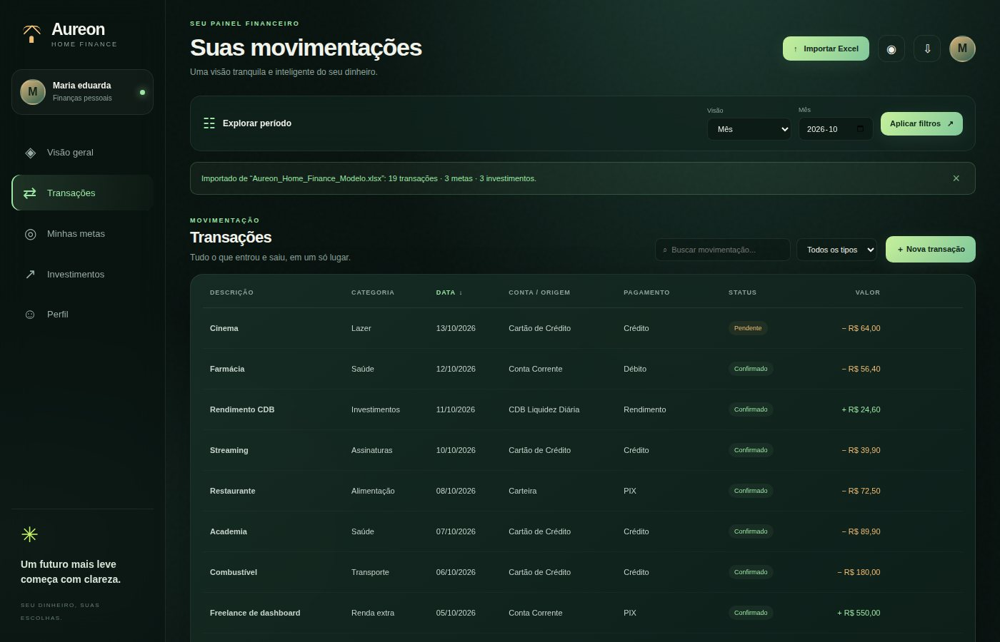
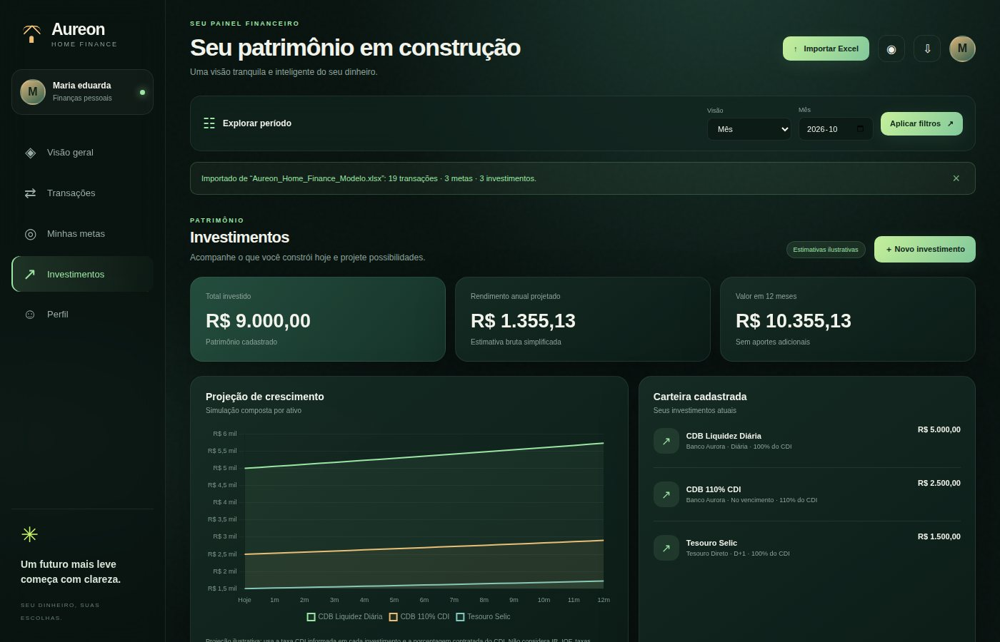
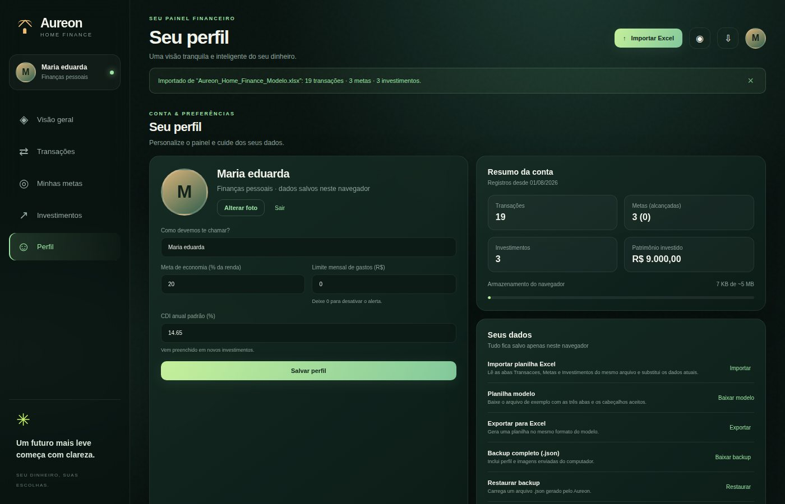

# 💰 Aureon Home Finance

Aplicação web desenvolvida para **organizar as finanças pessoais a partir de uma planilha Excel**, permitindo visualizar para onde o dinheiro está indo, acompanhar metas e projetar o crescimento dos investimentos.

🌐 **Acesse o projeto:** *(adicione o link quando houver uma versão publicada)*

---

## 📌 Sobre o projeto

O **Aureon Home Finance** nasceu de uma dúvida comum para quem controla as finanças em planilhas:

> **Para onde meu dinheiro está indo? Estou guardando o suficiente? Quanto falta para minhas metas?**

A aplicação lê uma planilha Excel com **transações, metas e investimentos** e transforma esses dados em um painel visual: saldo, entradas, saídas, gastos por categoria, progresso das metas e projeção de rendimento.

Tudo roda **100% no navegador**: não existe servidor, conta online nem envio de dados. Suas informações ficam apenas no seu computador.

O projeto foi desenvolvido como uma aplicação prática de conceitos de **desenvolvimento web, organização de código, matemática financeira e visualização de dados**.

---

## 🎯 Objetivo

O principal objetivo do projeto é tornar o acompanhamento financeiro mais simples e visual, ajudando o usuário a entender:

- Quanto entrou e quanto saiu no período escolhido;
- Qual percentual da renda está sendo guardado;
- Em quais categorias o dinheiro está sendo gasto;
- Se os gastos do mês estão próximos de um limite definido;
- Quanto falta para alcançar cada meta;
- Quanto os investimentos podem render nos próximos 12 meses.

> ⚠️ **Importante:** o projeto possui finalidade educacional e de organização pessoal. As projeções de investimento são estimativas simplificadas e não representam recomendação ou garantia de rentabilidade.

---

## 🖼️ Preview

### 🏠 Interface

#### Boas-vindas


#### Primeira abertura


#### Visão geral


#### Transações


#### Metas


#### Investimentos


#### Perfil


---

## ✨ Funcionalidades

### 📥 Importação de planilha Excel

- Lê as abas **Transacoes**, **Metas** e **Investimentos** do **mesmo arquivo**;
- Aceita nomes de abas e cabeçalhos com ou sem acento, em maiúsculas ou minúsculas;
- Reconhece variações de **Entrada** e **Saída** (`Saída`, `Saida`, `SAIDA`, `despesa`, `débito`, valores negativos, colunas separadas...);
- Mostra avisos do que foi ignorado ou não reconhecido (linhas sem data, tipos desconhecidos, valores zerados);
- Pede confirmação antes de substituir dados já existentes;
- Disponibiliza uma **planilha modelo** para download.

### 📊 Visão geral

- Saldo, entradas, saídas e taxa de economia do período;
- Filtro por mês, ano, data específica ou todo o período;
- Gráfico de fluxo financeiro (entradas x saídas);
- Gastos por categoria em gráfico de rosca;
- Movimentações recentes e prévia das metas;
- Alerta quando os gastos do mês passam de 80% do limite definido no perfil.

### 🔁 Transações

- Cadastro, edição e exclusão de transações;
- Busca (ignorando acentos) e filtro por tipo;
- Ordenação clicando nos cabeçalhos da tabela;
- Totais de entradas e saídas da lista exibida.

### 🎯 Metas

- Cartões com progresso, prazo, prioridade e valor restante;
- Cadastro, edição e exclusão de metas;
- **Aportes** rápidos, com aviso ao alcançar a meta;
- Imagem em cada meta (arquivo do computador, link ou pasta `img/`).

### 📈 Investimentos

- Total investido, rendimento anual projetado e valor em 12 meses;
- Gráfico de projeção por ativo;
- Carteira com cadastro, edição e exclusão de investimentos.

### 👤 Perfil

- Tela de boas-vindas que pede o nome na primeira abertura;
- Saudação por horário e avatar com a inicial (ou foto);
- Meta de economia, limite mensal de gastos e CDI padrão;
- Resumo da conta e medidor de armazenamento do navegador;
- **Modo privacidade**, que borra valores e gráficos.

### 💾 Seus dados

- Exportação para Excel no mesmo formato da planilha modelo;
- **Backup completo em JSON**, incluindo perfil e imagens enviadas;
- Restauração de backup e opção de limpar todos os dados.

### 🎨 Interface

- Design responsivo, com tema escuro;
- Animações, hovers e transições em CSS e JavaScript;
- Navegação por teclado, foco visível e suporte a `prefers-reduced-motion`;
- Avisos e confirmações no próprio app.

---

## 🛠️ Tecnologias utilizadas

### Frontend

- HTML5
- CSS3 (variáveis, Grid e Flexbox)
- JavaScript (ES6+)

### Bibliotecas e recursos

- Chart.js
- SheetJS (leitura e escrita de Excel)
- `localStorage` (persistência no navegador)

### Ferramentas

- Node.js (build dos partials de HTML e testes)
- Prettier
- Git
- GitHub e GitHub Actions
- Vercel
- Visual Studio Code

> Não há backend. As bibliotecas ficam em `vendor/`, então o app funciona offline.

---

## 📂 Estrutura do projeto

```text
Aureon Home Finance/
│
├── src/
│   ├── index.template.html
│   └── partials/
│       ├── views/
│       └── modals/
│
├── css/
│   ├── layout/
│   ├── components/
│   ├── views/
│   ├── tokens.css
│   ├── base.css
│   ├── interactions.css
│   └── responsive.css
│
├── js/
│   ├── core/
│   ├── data/
│   ├── services/
│   ├── components/
│   ├── views/
│   └── app.js
│
├── assets/
├── vendor/
├── tests/
├── docs/
├── img/
│
├── build.mjs
├── index.html
├── vercel.json
├── package.json
├── .gitignore
├── LICENSE
└── README.md
```

### Organização

A aplicação utiliza uma estrutura modular para separar as principais responsabilidades:

- `src/` → esqueleto e partials do HTML (uma tela ou modal por arquivo);
- `css/tokens.css` → todas as cores, fontes, raios, sombras e durações do design;
- `js/core/` → configuração, utilitários, estado (`store`), navegação e persistência;
- `js/data/` → vocabulário, leitura da planilha, formato dos dados salvos e backup;
- `js/services/` → filtros, cálculos financeiros e operações de cadastro;
- `js/components/` → avisos, modais, gráficos, avatar e processamento de imagens;
- `js/views/` → uma tela por arquivo;
- `assets/` → planilha modelo e favicon;
- `vendor/` → SheetJS e Chart.js, com as respectivas licenças;
- `tests/` → testes unitários;
- `docs/` → imagens deste README;
- `img/` → fotos das metas (opcional);
- `build.mjs` → monta o `index.html` a partir de `src/`;
- `index.html` → arquivo **gerado**, versionado para o app abrir direto do clone.

---

## 🚀 Como utilizar

### 1. Usar o aplicativo

Abra o `index.html` no Chrome ou Edge (duplo clique) ou acesse a versão publicada.

1. Informe seu nome na tela de boas-vindas;
2. O app começa **vazio**: baixe a **planilha modelo** (painel inicial ou aba *Perfil*);
3. Preencha as abas e clique em **Importar Excel**.

### 2. Preparar a planilha

Abas reconhecidas: `Transacoes`, `Metas` e `Investimentos`. Uma aba que não existe resulta em lista vazia. `*` indica coluna obrigatória.

| Aba | Colunas |
|---|---|
| **Transacoes** | `Data`*, `Valor`*, `Tipo`, `Descricao`, `Categoria`, `Conta_Origem`, `Meio_Pagamento`, `Status`, `Subcategoria`, `Instituicao`, `Recorrente`, `Observacoes`, `ID` |
| **Metas** | `Meta`*, `Valor_Alvo`*, `Valor_Atual`, `Data_Alvo`, `Prioridade`, `Imagem_URL`, `Observacoes` |
| **Investimentos** | `Ativo`*, `Valor_Investido`*, `Taxa_Anual_%_CDI`, `CDI_Anual_%`, `Instituicao`, `Tipo`, `Liquidez`, `Data_Aplicacao`, `Vencimento`, `Observacoes` |

Datas aceitam `2026-10-01`, `01/10/2026` e datas nativas do Excel. Valores aceitam número ou texto (`R$ 1.234,56`, `-5,00`, `(5,00)`).

### 3. Imagens das metas

No modal da meta ou na coluna `Imagem_URL`:

1. **Link direto da imagem** — deve abrir só a imagem ao ser colado numa aba (termina em `.jpg`, `.png` ou `.webp`);
2. **Arquivo na pasta `img/`** — use o caminho relativo, como `img/civic.jpg`;
3. **Upload pelo modal** — reduzido no navegador e guardado localmente (não vai para a planilha, mas entra no backup JSON).

Links de compartilhamento do Google Drive e do Dropbox são convertidos automaticamente. Links de páginas (Google Imagens, Pinterest, Instagram) não funcionam.

### 4. Rodar para desenvolvimento

Requisito: Node.js 18 ou superior (apenas para desenvolver; para usar o app não é necessário).

Clone o repositório:

```bash
git clone https://github.com/jullyoo/aureon-home-finance.git
```

Acesse a pasta do projeto:

```bash
cd aureon-home-finance
```

Instale as dependências de desenvolvimento:

```bash
npm install
```

Regenere o `index.html` automaticamente ao editar os partials em `src/`:

```bash
npm run watch
```

Abra o `index.html` no navegador. Outros comandos úteis:

```bash
npm run check       # formatação + testes + index.html em dia
npm test            # testes unitários
npm run format      # formata o código com Prettier
npm run build:dist  # gera dist/ para publicação
```

> Edite sempre os arquivos em `src/`. O `index.html` é gerado e será sobrescrito.

### 5. Publicar na Vercel

1. Envie o projeto para o GitHub (`git add .`, `git commit`, `git push`);
2. Na Vercel, escolha **Add New → Project** e importe o repositório;
3. Clique em **Deploy**. O `vercel.json` já define o build, a pasta de saída e os cabeçalhos de segurança.

---

## 📈 Sobre os cálculos

### Indicadores do painel

| Indicador | Como é calculado |
|---|---|
| Saldo do período | Entradas − Saídas (transações canceladas são ignoradas) |
| Taxa de economia | Saldo ÷ Entradas × 100 |
| Progresso da meta | Valor atual ÷ Valor alvo (limitado a 100%) |
| Valor restante da meta | Valor alvo − Valor atual |

### Alerta de orçamento

Quando um limite mensal de gastos é definido no perfil, o painel compara as saídas do mês com esse limite:

| Uso do limite | Situação |
|---|---|
| Abaixo de 80% | Sem alerta |
| De 80% a 99% | Atenção |
| 100% ou mais | Limite ultrapassado |

### Como o app entende Entrada e Saída

Maiúsculas, minúsculas, acentos e espaços sobrando **não importam**. Para cada linha, nesta ordem:

| Ordem | Regra |
|---:|---|
| 1 | Coluna `Tipo` reconhecida (Entrada, receita, crédito, salário... ou Saída, despesa, débito, gasto...) |
| 2 | Valor negativo (`-50` ou `(50,00)`) vale como Saída |
| 3 | Sem coluna `Tipo` e com valores negativos: os positivos valem como Entrada |
| 4 | Colunas separadas `Entrada` e `Saída`: vale a coluna preenchida |
| 5 | Qualquer outro caso vira Saída, e o app avisa o que não reconheceu |

Para ensinar uma palavra nova ao app, basta acrescentá-la nas listas de `js/data/vocabulary.js`.

### Projeção de investimentos

O projeto utiliza **juros compostos** sobre a taxa CDI informada e o percentual contratado:

```text
valor_futuro = valor × (1 + CDI × %CDI) ^ (meses ÷ 12)
```

Exemplo: R$ 1.000,00 em um investimento de 110% do CDI, com CDI a 14,65% ao ano, chegam a **R$ 1.161,15** em 12 meses.

> A projeção é uma estimativa bruta simplificada: **não considera Imposto de Renda, IOF, taxas, marcação a mercado ou variação futura do CDI**.

---

## 🔒 Privacidade e segurança

- Todo o processamento acontece no navegador; nenhum dado é enviado a servidores;
- Os dados ficam no `localStorage` (limite aproximado de 5 MB). Limpar os dados do navegador apaga a cópia local, então baixe um **backup** de vez em quando;
- O `.gitignore` impede que planilhas (`*.xlsx`, `*.xls`, `*.csv`) e backups (`Aureon_Backup_*.json`) sejam enviados ao GitHub. Apenas a planilha modelo, com dados fictícios, é versionada;
- O `vercel.json` aplica uma Content-Security-Policy restritiva e outros cabeçalhos de segurança;
- A versão do SheetJS disponível no npm é a `0.18.5`; importe apenas planilhas suas ou de fontes confiáveis.

---

## 🔮 Próximos passos

Entre as possíveis evoluções do projeto estão:

- 📄 Exportação do painel em PDF;
- 🏦 Importação de extratos bancários (CSV/OFX);
- 🔁 Metas com aportes recorrentes;
- 🏷️ Categorias e orçamentos personalizados por categoria;
- 🌗 Tema claro;
- 📱 Versão instalável (PWA) para uso offline;
- 💹 Projeção de investimentos com Imposto de Renda;
- 📊 Comparativo entre meses.

---

## 👨‍💻 Autor

**Julio Guimarães**

Projeto desenvolvido para fins de **estudo, portfólio e aplicação prática de conhecimentos em Desenvolvimento Web e Análise de Dados**.

- 💻 GitHub: https://github.com/jullyoo
- 💼 LinkedIn: https://www.linkedin.com/in/j-guimaraes/
- 🌐 Portfólio: https://jullyoo.github.io/Julyo.dev/

---

## 📄 Licença

Distribuído sob a licença [MIT](LICENSE). Bibliotecas de terceiros em `vendor/`: [SheetJS CE](vendor/LICENSE-sheetjs.txt) (Apache-2.0) e [Chart.js](vendor/LICENSE-chartjs.txt) (MIT).

---

⭐ "Se eu não comprar nada, o desconto é bem maior." - Julius Rock (Todo Mundo Odeia o Chris)